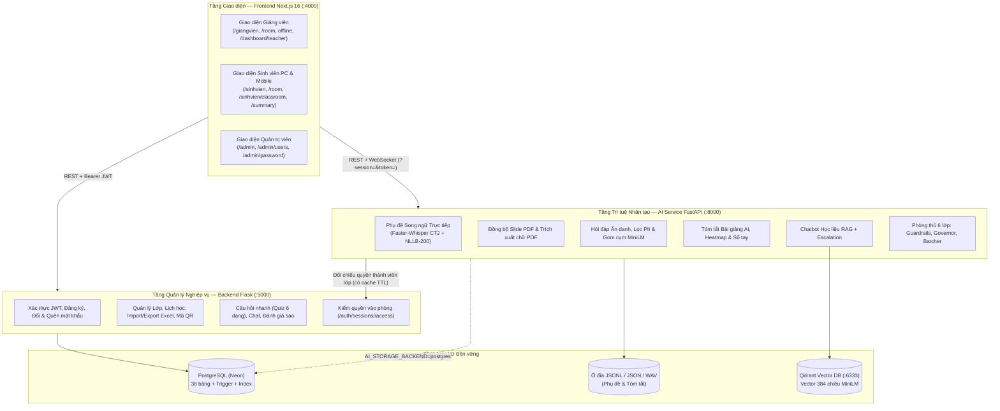

# BÁO CÁO PHẦN 1: TỔNG QUAN KIẾN TRÚC & TOÀN BỘ CHỨC NĂNG DỰ ÁN CLASSBRIDGE

Tài liệu này là **Tập 1** trong bộ 3 báo cáo kỹ thuật tổng hợp của dự án **ClassBridge — Hệ thống Trợ lý AI Hỗ trợ Lớp học Song ngữ Anh–Việt (EMI)**, giúp người đọc nắm trọn bức tranh tổng thể: hệ thống gồm những phần nào, đã xử lý xong những gì, và toàn bộ luồng vận hành từ đầu đến cuối diễn ra như thế nào.

- Xem chi tiết mã nguồn Backend Flask & CSDL tại: [`2_BAOCAO_CODE_BACKEND_VA_CSDL.md`](2_BAOCAO_CODE_BACKEND_VA_CSDL.md)
- Xem chi tiết mã nguồn AI Service & Frontend tại: [`3_BAOCAO_CODE_AI_VA_FRONTEND.md`](3_BAOCAO_CODE_AI_VA_FRONTEND.md)

---

## 1. Kiến trúc Tổng thể 3 Phân hệ Độc lập

ClassBridge tách biệt rõ ràng **Nghiệp vụ Quản lý Lớp học (I/O nhẹ)** và **Xử lý Mô hình Trí tuệ Nhân tạo Thời gian thực (GPU/CPU nặng)** thành 3 dịch vụ giao tiếp qua HTTP REST và WebSocket, liên kết chặt chẽ bằng mã định danh phiên học `session_id` (UUID chuẩn hóa chữ thường) và khóa ký `SECRET_KEY` dùng chung:

### Vì sao kiến trúc này chạy ổn định?
1. **Không nghẽn chéo (Bulkhead Isolation)**: Khi giảng viên nói liên tục và GPU đang giải mã âm thanh Whisper + dịch NLLB-200 ở cổng `:8000`, các thao tác đăng nhập, điểm danh, làm bài Quiz trắc nghiệm ở cổng `:5000` vẫn phản hồi tức thì dưới vài chục mili-giây.
2. **Bảo mật xuyên suốt (Zero-Trust Room Access)**: `ai-service` không tin dữ liệu client tự khai báo mà tự xác thực chữ ký JWT bằng `SECRET_KEY`, sau đó hỏi Flask (`GET /auth/sessions/<session_id>/access`) đúng 1 lần rồi lưu đệm RAM 5 phút — áp dụng trên **cả API REST lẫn cả 3 kênh WebSocket** (`/ws/live-translate`, `/ws/qa`, `/ws/slides`).
3. **Tự động thích ứng mạng Wi-Fi/LAN nội bộ**: Khi sinh viên dùng điện thoại quét mã QR trên màn chiếu vào địa chỉ LAN (`http://192.168.1.x:4000`), Frontend và bộ lọc CORS RFC1918 của cả hai Backend tự động ánh xạ đúng IP máy chủ mà không cần sửa tay cấu hình `.env.local`.

---

## 2. Tổng hợp Toàn bộ 10 Nhóm Chức năng Đã Xử lý Hoàn chỉnh

| STT | Nhóm chức năng | Những gì hệ thống đã xử lý trọn vẹn |
| :-: | :--- | :--- |
| **1** | **Tài khoản, Đổi mật khẩu & Quên mật khẩu** | Đăng ký sinh viên 3 bước; Đăng nhập phân luồng theo 3 vai trò (`sinh_vien`, `giang_vien`, `admin`); **Đổi mật khẩu chủ động** cho cả 3 vai trò; **Quên mật khẩu 3 bước** chọn số qua Email cấp `resetToken` một lần, lưu băm an toàn vào bảng `otp_verifications` & `password_reset_tokens`. |
| **2** | **Quản lý Lớp học, Excel & Mã QR** | Giảng viên tạo/sửa/xóa lớp, tự sinh lịch buổi học hàng tuần, tải mẫu và **Import/Export danh sách lớp bằng Excel**; hiển thị **Mã QR trực tiếp** để sinh viên quét bằng camera trình duyệt (`BarcodeDetector`) hoặc điện thoại. |
| **3** | **Phòng chờ & Vòng đời Phiên học** | Chuyển trạng thái phiên `SCHEDULED → LIVE → ENDED` (hỗ trợ cả chế độ **Online** và **Offline**); sinh viên vào sớm tự động đợi ở phòng chờ và tự chuyển vào lớp ngay khi giảng viên mở phiên; ghi nhận điểm danh `student_sessions`. |
| **4** | **Phụ đề Song ngữ Thời gian thực (Online & Offline)** | Thu âm trình duyệt bằng `AudioWorklet` kèm bộ lọc chống răng cưa **Butterworth bậc 4**; cắt câu theo khoảng lặng; nhận dạng giọng nói bằng **Faster-Whisper CTranslate2** (chống ảo giác lúc im lặng); dịch máy bất đồng bộ **NLLB-200** giữ đúng thứ tự câu; tự lưu file `.jsonl`, `.txt`, `.wav`. |
| **5** | **Đồng bộ Slide PDF & Trích xuất chữ Slide** | Tải lên PDF tối đa 20 MB (tự đồng bộ từ phòng Offline sang phòng AI); giảng viên lật trang tới đâu màn hình sinh viên tự nhảy trang tới đó qua `/ws/slides`; tự động **bóc tách văn bản từng trang PDF** phục vụ Tóm tắt & Chatbot RAG. |
| **6** | **Hỏi đáp Ẩn danh, Gom cụm AI & Dịch câu trả lời** | Tự động che SĐT/Email/MSSV (`PII Masking`) trong câu hỏi sinh viên; nhúng ngữ nghĩa đa ngôn ngữ `MiniLM-L12-v2` gom các câu hỏi trùng ý thành cụm chủ đề; giảng viên trả lời 1 lần → **tự động dịch song ngữ Anh–Việt** và phát thông báo nổi (`QAToast`) tới cả lớp. |
| **7** | **Câu hỏi nhanh / Quiz 6 dạng 2 chiều + Giọng nói** | Giảng viên soạn hoặc **đọc câu hỏi bằng giọng nói** (*Web Speech API*) với 6 dạng (`POLL`, `MULTIPLE_CHOICE` có ảnh, `TRUE_FALSE`, `SHORT_ANSWER`, `ORDERING`, `MATCHING`); sinh viên làm bài ngay trên điện thoại (ẩn đáp án trước khi nộp) và được chấm điểm tự động. |
| **8** | **Tóm tắt Bài giảng AI, Heatmap & Sổ tay** | Kết hợp **lời giảng phụ đề + văn bản trích xuất từ PDF Slide + câu hỏi Q&A** để sinh 6 mục tóm tắt chuẩn học thuật, **Bản đồ nhiệt mức độ thắc mắc theo từng trang Slide (Heatmap)**, chỉnh sửa lưu phiên bản (`v1, v2...`), sổ tay ghi chú riêng của sinh viên, đánh giá 1–5 sao và **In / Xuất PDF**. |
| **9** | **Chatbot Hỏi đáp Học liệu (RAG + Escalation)** | Chia nhỏ nội dung Slide & phụ đề (overlap 15%), đối chiếu vector ngữ nghĩa với Qdrant / MiniLM, trả lời kèm trích dẫn `[Slide #X]`; nếu câu hỏi ngoài phạm vi tài liệu trả `NO_SOURCE_FOUND` (không bịa đặt) và cho phép bấm **1 chạm chuyển thẳng lên giảng viên**. |
| **10** | **Phòng thủ AI 6 lớp, Chịu tải & CI/CD** | Hàng đợi gom lô `DynamicBatcher` trả chuẩn `429 Retry-After` & `504` theo `budget_ms`, chống gửi đúp `Idempotency-Key`, chặn 12 mẫu tấn công *Prompt Injection*, công tắc ngắt khẩn cấp **Kill Switch** (`ExecutionGovernor`), `/api/v1/metrics`, `.github/workflows/ci.yml`, `.gitleaks.toml` và `drift_meter.py`. |

---

## 3. Hành trình Hoạt động Thực tế của Một Buổi học trên ClassBridge

1. **Giai đoạn 1 — Chuẩn bị trước giờ học**:
   - Giảng viên đăng nhập `/login`, vào `/giangvien/classes` tạo lớp (hoặc Import từ file Excel) → hệ thống tự sinh `class_code` và chuỗi các buổi học `SCHEDULED`.
   - Sinh viên mở web trên laptop hoặc điện thoại, quét **Mã QR** của giảng viên (hoặc nhập mã lớp) → được ghi danh vào `class_members` và đứng đợi tại **Phòng chờ** nếu chưa tới giờ.
2. **Giai đoạn 2 — Điều hành trực tiếp trong giờ học (`LIVE`)**:
   - Giảng viên mở buổi học ở chế độ **Online (`/room`)** hoặc **Offline (`/giangvien/classroom/[id]/offline`)**, tải lên Slide PDF và bật nút **Micro**.
   - Lời nói của giảng viên đi qua bộ lọc âm thanh 16 kHz → `ai-service` phát phụ đề gốc ngay lập tức rồi gửi bản dịch song ngữ nối tiếp sau vài trăm mili-giây; mỗi lần giảng viên bấm chuyển trang Slide, màn hình sinh viên tự lật theo và ghi lại mốc thời gian dừng ở từng trang.
   - Sinh viên gặp chỗ khó hiểu có thể:
     - Hỏi ngay **Trợ lý AI Học liệu (tab AI Học liệu)** để xem giải thích trích từ `[Slide #N]`; nếu vẫn chưa rõ, bấm *"Chuyển câu hỏi cho giảng viên"*.
     - Gửi **Câu hỏi ẩn danh** (hệ thống tự che mọi SĐT/MSSV nếu lỡ gõ vào). Giảng viên mở `/dashboard/teacher` bấm gom cụm AI để trả lời 1 lần cho hàng chục câu trùng ý (tự dịch song ngữ cho cả lớp).
     - Làm **Quiz / Câu hỏi nhanh** do giảng viên phát trực tiếp và biết kết quả đúng/sai ngay sau khi nộp.
3. **Giai đoạn 3 — Tổng kết & Ôn tập sau giờ học (`ENDED`)**:
   - Giảng viên bấm **Kết thúc buổi học** → hệ thống chuyển thẳng sang trang **Tóm tắt bài giảng & Heatmap (`/giangvien/summary`)**.
   - Bộ tổng hợp AI kết hợp lời giảng + nội dung chữ trên Slide PDF + mật độ câu hỏi theo từng trang Slide để chỉ rõ trang Slide nào nhiều sinh viên vướng mắc nhất (`critical`), cho phép giảng viên hiệu đính, xuất PDF và để sinh viên lưu vào sổ tay cá nhân (`/summary`) kèm gửi đánh giá sao cuối buổi.
