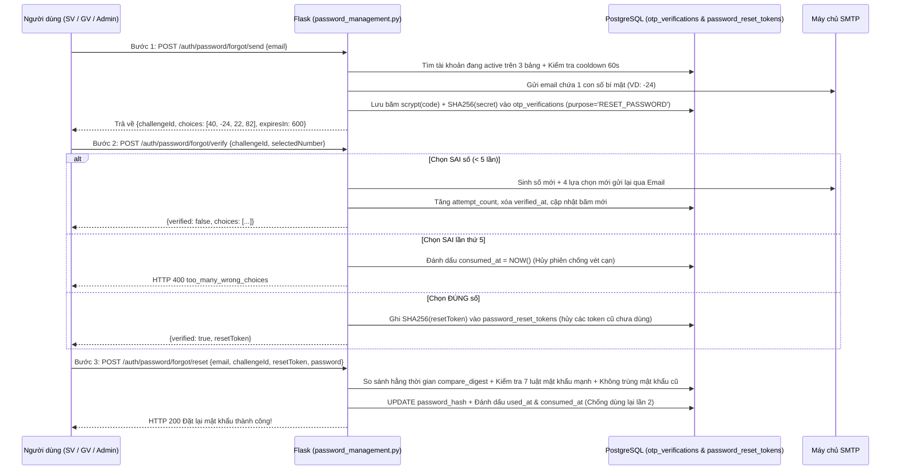

# BÁO CÁO PHẦN 2: GIẢI THÍCH CHI TIẾT CODE BACKEND FLASK & CƠ SỞ DỮ LIỆU

Tài liệu này là **Tập 2** trong bộ 3 báo cáo kỹ thuật của dự án **ClassBridge**, mô tả chi tiết cấu trúc thư mục, nhiệm vụ từng tệp code và thuật toán xử lý bên trong **Backend Flask (`backend/`, cổng `:5000`)** cùng lược đồ **PostgreSQL (`db.sql`)**.

---

## 1. Sơ đồ Tổ chức Mã nguồn `backend/`

```text
backend/
├── app.py                        # Khởi tạo Flask, gắn 19 Blueprints, xử lý CORS mạng LAN & ghi Audit tự động
├── config.py                     # Đọc biến môi trường (.env), kiểm tra độ dài SECRET_KEY >= 32 ký tự
├── extensions.py                 # Khởi tạo đối tượng SQLAlchemy `db` dùng chung
├── auth_utils.py                 # Decorator `@role_required(...)` kiểm tra vai trò từ JWT claims
├── verification_service.py       # Quản lý OTP Đăng ký & Quên mật khẩu (lưu SQL băm 1 chiều + gửi SMTP)
├── account_service.py            # Kiểm tra email tồn tại xuyên suốt cả 3 bảng tài khoản
├── email_utils.py                # Regex kiểm định chặt định dạng địa chỉ email chuẩn RFC
├── request_limits.py             # Bộ giới hạn tần suất (Sliding-Window Rate Limiter) chống brute-force theo IP
├── audit_service.py              # Tự động ghi nhật ký thao tác hệ thống vào bảng `audit_logs`
├── migrations/                   # Các bản vá SQL tăng trưởng từ 001 -> 005 (Trigger updated_at & Index)
└── routes/
    ├── __init__.py               # Tập hợp danh sách `route_blueprints` đăng ký vào `app.py`
    ├── login.py                  # POST /auth/login, POST /auth/logout
    ├── password_management.py    # POST /auth/change-password & 3 bước /auth/password/forgot/send|verify|reset
    ├── send_verification.py      # POST /auth/verification/send (Bước 1 đăng ký sinh viên)
    ├── verify_verification.py    # POST /auth/verification/verify (Bước 2 chọn con số xác thực)
    ├── register_account_student.py # POST /auth/register (Bước 3 tạo tài khoản sinh viên có khóa chống đua)
    ├── session_access.py         # GET /auth/sessions/<id>/access (Cầu nối phân quyền sang ai-service)
    ├── session_features.py       # Quiz sinh viên 6 dạng, Đánh giá sao buổi học, Hồ sơ GV, Danh sách phiên tóm tắt
    ├── student_classes.py        # Sinh viên tham gia lớp bằng mã/QR, vào/rời phiên học (`student_sessions`)
    ├── chat.py                   # Tin nhắn thảo luận trực tiếp trong phiên học
    ├── activity.py               # Ghi nhận hành vi tương tác người dùng trên giao diện
    ├── giangvien/                # Các cụm API dành riêng cho Giảng viên (lớp học, chi tiết phiên, câu hỏi nhanh, dashboard)
    └── admin/                    # Các cụm API dành riêng cho Quản trị viên (người dùng, lớp, nhật ký, độ tương tác)
```

---

## 2. Cơ chế Hoạt động của Từng Khối Nghiệp vụ Quan trọng

### 2.1. Khởi động An toàn, CORS Mạng LAN & Giới hạn Tần suất (`app.py`, `config.py`, `request_limits.py`)
1. **Chặn khởi động nếu khóa yếu (`config.py`)**:
   - Hàm `_require_secret_key()` bắt buộc biến `SECRET_KEY` phải có mặt và dài **tối thiểu 32 ký tự**. Nếu thiếu, server dừng ngay lúc khởi động chứ không bao giờ chạy với khóa rỗng hoặc mặc định.
   - Thời hạn sống của JWT được tách riêng theo đặc thù công việc: Quản trị viên `1 giờ` (`ADMIN_TOKEN_HOURS`), Giảng viên `8 giờ` (`LECTURER_TOKEN_HOURS` — đủ dạy trọn ca), Sinh viên `4 giờ` (`STUDENT_TOKEN_HOURS`).
2. **CORS thông minh hỗ trợ quét QR trên điện thoại (`app.py`)**:
   - Hàm `add_cors_headers()` sau mỗi request kiểm tra header `Origin`: ngoài các địa chỉ cấu hình trong `FRONTEND_ORIGIN` (mặc định `http://localhost:4000`), hàm `_is_private_lan_origin()` dùng thư viện chuẩn `ipaddress` để cho phép các thiết bị nằm trong dải IP nội bộ RFC1918 (`192.168.x.x`, `10.x.x.x`, `172.16–31.x.x`) cùng cổng gọi API, đồng thời **chặn tuyệt đối** mọi tên miền Internet lạ bên ngoài.
3. **Chống tấn công dò mật khẩu (`request_limits.py`)**:
   - Lưu cửa sổ trượt thời gian theo cặp `(tên_hành_động, địa_chỉ_IP)`. Ví dụ: `/auth/login` và `/auth/change-password` giới hạn tối đa `10 lần / 15 phút`; gửi mã email giới hạn `5 lần / 15 phút` kết hợp thời gian chờ `cooldown 60 giây` cho mỗi địa chỉ email.

---

### 2.2. Luồng Mật khẩu & Xác thực Số qua Email Bền vững (`verification_service.py`, `password_management.py`)

Thay vì dùng mã OTP 6 chữ số dễ bị đoán hoặc nhập nhầm, ClassBridge sử dụng **Thử thách Chọn Đúng Con Số (4-Choice Number Challenge từ `-100` đến `100`)**:



**Điểm nhấn an toàn trong code**:
- **Không lưu dạng rõ**: Cả con số xác thực lẫn `resetToken` đều được băm một chiều (`generate_password_hash` / `hashlib.sha256`) trước khi ghi xuống CSDL.
- **Cô lập mục đích (`purpose`)**: Challenge của luồng Đăng ký (`purpose='REGISTER'`) và luồng Quên mật khẩu (`purpose='RESET_PASSWORD'`) bị tách rời từ tầng truy vấn SQL, không thể lấy challenge đã xác thực khi đăng ký để gọi sang API đặt lại mật khẩu.
- **Khóa chống đua khi đăng ký (`register_account_student.py`)**: Dùng `SELECT pg_advisory_xact_lock(hashtextextended(:email, 0))` của PostgreSQL để ngăn hai request song song tạo trùng cùng một email hoặc MSSV.

---

### 2.3. Cầu nối Phân quyền Phòng học giữa hai Backend (`routes/session_access.py`)
Khi người dùng mở phòng học hoặc xem tóm tắt trên `ai-service` (`:8000`), `ai-service` gọi nội bộ về Flask:
- `GET /auth/sessions/<session_id>/access` (trong giờ học trực tiếp)
- `GET /auth/sessions/<session_id>/access?allow_closed=1` (khi xem lại phụ đề, Tóm tắt bài giảng hoặc hỏi Chatbot RAG sau buổi học)

**Cách code xử lý**:
1. Kiểm tra `session_id` đúng chuẩn UUID và tra cứu trạng thái phiên trong bảng `sessions` nối với `classes`.
2. Nếu phiên bị hủy (`CANCELLED`), hoặc phiên đã kết thúc (`ENDED`) mà không có cờ `allow_closed=1` → trả ngay `HTTP 403 {"code": "session_closed"}`.
3. Kiểm tra vai trò người gọi:
   - `admin` đang hoạt động → trả `{"access": "admin"}`.
   - `giang_vien` là chủ lớp (`classes.lecturer_id`) → trả `{"access": "lecturer"}`.
   - `sinh_vien` có mặt trong `class_members` với trạng thái `ACTIVE` → trả `{"access": "student"}`.
   - Mọi trường hợp khác (sinh viên lớp khác, tài khoản bị khóa) → trả `HTTP 403 {"code": "session_forbidden"}`.

---

### 2.4. Xử lý Câu hỏi nhanh 6 dạng & Chống lộ đáp án (`routes/session_features.py`)
- **Khi Sinh viên tải đề (`GET /auth/student/sessions/<id>/quick-questions`)**:
  - Code kiểm tra sinh viên đã nộp câu đó chưa (`already_answered = my_resp is not None`).
  - Nếu **chưa nộp**: Trường `isCorrect` của mọi phương án bị ép về `None` (không gửi xuống JSON trình duyệt để sinh viên không mở DevTools F12 xem trước đáp án!). Với câu `ORDERING`, danh sách mục được sắp xếp lại theo bảng chữ cái; với câu `MATCHING`, cột bên phải cũng được xáo trộn độc lập với cột trái.
  - Chỉ **sau khi đã nộp bài**, API mới trả `isCorrect` và đáp án chuẩn để giao diện hiển thị kết quả xanh/đỏ.
- **Khi Sinh viên nộp bài (`POST .../respond`)**:
  - Tự động đảm bảo bản ghi điểm danh `student_sessions` tồn tại (`INSERT ... ON CONFLICT DO UPDATE`), chấm điểm chính xác cho từng loại (`MULTIPLE_CHOICE`, `TRUE_FALSE`, `ORDERING` so khớp mảng không phân biệt hoa thường, `MATCHING` đối chiếu ánh xạ từng cặp trái–phải) và lưu vào bảng `quick_question_responses`.

---

## 3. Thiết kế Cơ sở dữ liệu PostgreSQL (`db.sql` & `migrations/005`)

Lược đồ `db.sql` gồm **38 bảng chuẩn hóa** chia thành 9 phân vùng nghiệp vụ:
1. **Tài khoản & Bảo mật**: `admins`, `lecturers`, `students`, `otp_verifications`, `password_reset_tokens`.
2. **Môn học, Lớp & Lịch**: `courses`, `classes`, `class_members`, `schedule_imports`, `class_schedules`.
3. **Phiên học trực tiếp**: `sessions`, `student_sessions`.
4. **Học liệu, Slide & Phụ đề**: `lecture_files`, `lecture_slides`, `transcripts`, `transcript_translations`, `lecture_chunks`.
5. **Tóm tắt AI & Ghi chú**: `lesson_summaries`, `lesson_summary_versions`, `student_notes`, `domain_keywords`.
6. **Hỏi đáp, Gom cụm & Quiz**: `questions`, `question_groups`, `question_group_members`, `answers`, `quick_questions`, `quick_question_options`, `quick_question_responses`, `session_chat_messages`.
7. **Chatbot RAG**: `chatbot_conversations`, `chatbot_messages`, `chatbot_escalations`.
8. **Thống kê, Heatmap & Phản hồi**: `session_analytics`, `confusion_metrics`, `session_feedback`.
9. **Quản trị & Vận hành**: `system_settings`, `user_notifications`, `audit_logs`.

Tệp `backend/migrations/005_optimize_indexes_triggers.sql` bổ sung hàm trigger `fn_set_updated_at()` tự động cập nhật cột `updated_at` khi `UPDATE` và hệ thống chỉ mục kết hợp (*Composite Indexes*) trên `(session_id, created_at)` giúp các truy vấn thống kê lịch sử luôn đạt tốc độ cao.
