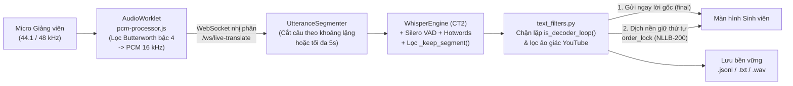

# BÁO CÁO PHẦN 3: GIẢI THÍCH CHI TIẾT CODE AI SERVICE & GIAO DIỆN FRONTEND

Tài liệu này là **Tập 3** trong bộ 3 báo cáo kỹ thuật của dự án **ClassBridge**, giải thích tường tận cách hoạt động của từng thuật toán, từng tệp code trong **AI Service FastAPI (`ai-service/`, cổng `:8000`)** và **Frontend Next.js 16 (`frontend/`, cổng `:4000`)**.

---

## 1. Cấu trúc & Nguyên lý Hoạt động của `ai-service/` (FastAPI `:8000`)

```text
ai-service/
├── main.py                           # Điểm vào FastAPI, CORS mạng LAN, middleware đo p50/p95/p99, /api/v1/metrics
├── core/
│   ├── lifespan.py                   # Nạp 1 lần NLLB-200 + Whisper CT2 + MiniLM + DynamicBatcher + RAG Service
│   ├── auth.py                       # Kiểm tra JWT HS256 cục bộ & hỏi quyền phòng Flask (cả REST lẫn WebSocket)
│   ├── session_scope.py              # Chuẩn hóa UUID chữ thường & cô lập dữ liệu từng phòng học (LRU 200 phiên)
│   ├── pg_stores.py                  # Lớp đồng bộ Write-Through sang PostgreSQL khi bật AI_STORAGE_BACKEND=postgres
│   ├── pii_masker.py                 # Tự động che Email, SĐT, MSSV 11 chữ số trong câu hỏi sinh viên
│   ├── guardrails.py                 # Chặn 12+ mẫu tấn công Prompt Injection tiếng Anh & tiếng Việt
│   ├── governor.py                   # Kiểm soát ngân sách token theo phiên, Kill Switch động & thống kê độ trễ
│   └── batcher.py                    # Hàng đợi gom lô DynamicBatcher (429 Retry-After, 504 budget_ms) & Idempotency
└── modules/
    ├── live_translate/               # Pipeline STT Faster-Whisper + cắt câu khoảng lặng + dịch NLLB-200 trực tiếp
    ├── slides/                       # Chia sẻ PDF, đồng bộ trang WebSocket & giải mã chữ PDF (pdf_extractor.py)
    ├── question_clustering/          # Gom cụm câu hỏi tương đồng ngữ nghĩa bằng MiniLM-L12-v2 + đồ thị ngưỡng
    ├── qa/                           # Lưu/phát câu hỏi ẩn danh & tự động dịch song ngữ câu trả lời giảng viên
    ├── summary/                      # Tổng hợp Tóm tắt bài giảng AI (lời giảng + chữ Slide + Q&A) & Heatmap
    └── rag_chatbot/                  # Chatbot Hỏi đáp Học liệu (RAG + Qdrant + Chuyển câu hỏi lên giảng viên)
```

---

### 1.1. Đường ống Thu âm, Nhận dạng Giọng nói (STT) & Phụ đề Song ngữ (`modules/live_translate/`)

Đây là luồng thời gian thực khắt khe nhất của hệ thống, được thiết kế chống nhiễu và chống hiện tượng Whisper "tự nhảy chữ ảo giác" khi giảng viên ngừng nói:



1. **Xử lý tín hiệu số ngay trên trình duyệt (`frontend/public/pcm-processor.js`)**:
   - Âm thanh thu từ micro máy tính thường ở tần số `48,000 Hz`, trong khi mô hình Whisper yêu cầu đúng `16,000 Hz`.
   - Nếu chỉ lấy mẫu thưa đơn giản sẽ sinh hiện tượng gập phổ (*aliasing*) tạo tiếng rít giả. Do đó `pcm-processor.js` cài đặt **2 tầng lọc thông thấp Biquad Butterworth bậc 4 nối tiếp** (hệ số $Q_1 = 0.5412$, $Q_2 = 1.3066$, tần số cắt $7.2\text{ kHz}$) kèm giữ trạng thái liên khối mượt mà trước khi nội suy tuyến tính về `16 kHz`.
2. **Nhận dạng chống ảo giác (`speech_engine.py` & `text_filters.py`)**:
   - Lúc khởi động (`lifespan.py`), hệ thống nạp `NLLB-200` trước rồi nạp `WhisperEngine` (tự động thử giải mã thật trên CUDA; nếu máy thiếu thư viện `cuBLAS`/`cuDNN` thì tự lùi êm về CPU `int8`).
   - Sau khi giải mã, hàm `_keep_segment()` loại bỏ ngay các đoạn có xác suất không có tiếng nói cao (`no_speech_prob >= 0.85`), chuỗi lặp (`compression_ratio > 2.4`), hoặc tạp âm phòng họp có độ tự tin thấp (`avg_logprob < -0.78`). Tiếp đó `is_decoder_loop()` và `is_hallucination()` chặn sạch các câu rác quen thuộc kiểu *"Subtitles by Amara"*, *"Cảm ơn các bạn đã theo dõi"*.
3. **Phát phụ đề lũy tiến giữ thứ tự FIFO (`router.py`)**:
   - Ngay khi STT nhận ra câu nói, server phát gói tin `{"type": "final"}` để sinh viên đọc được lời gốc tức thì.
   - Tác vụ dịch sang ngôn ngữ còn lại bằng mô hình `facebook/nllb-200-distilled-600M` chạy bất đồng bộ ở nền nhưng được điều phối bằng `order_lock = asyncio.Lock()` để đảm bảo câu nói trước luôn nhận bản dịch và ghi vào file `.jsonl` trước câu nói sau.

---

### 1.2. Thuật toán Gom cụm Câu hỏi Ngữ nghĩa Đa ngôn ngữ (`modules/question_clustering/`)

Khi lớp đông sinh viên cùng hỏi bằng cả tiếng Việt, tiếng Anh hoặc câu pha trộn (*"Deadlock là gì ạ?"* và *"What causes a deadlock?"*), lớp `CustomSemanticQuestionAggregator` thực hiện 5 bước:
1. **Chuẩn hóa song ngữ đối xứng (`_to_bilingual_text`)**: Dịch câu hỏi sang ngôn ngữ còn lại rồi ghép theo mẫu đối xứng `"{câu_gốc}. {bản_dịch}"` để vector biểu diễn không phụ thuộc sinh viên hỏi bằng tiếng Anh hay tiếng Việt.
2. **Nhúng Vector có Bộ nhớ đệm LRU Đa luồng (`encode_questions` + `_embedding_cache`)**: Mã hóa thành vector 384 chiều bằng `paraphrase-multilingual-MiniLM-L12-v2` và chuẩn hóa độ dài đơn vị ($\|\mathbf{v}\|_2 = 1$). Các câu hỏi đã nhúng được lưu trong `OrderedDict` tối đa `2048` mục bọc bởi `threading.Lock()` nên giảng viên bấm làm mới liên tục không tốn công tính lại.
3. **Đồ thị Tương đồng Ngưỡng (`ThresholdGraphClustering`)**: Tính ma trận tương đồng Cosine $S = V V^\top$; hai câu hỏi có độ tương đồng $\ge 0.78$ được nối cạnh và gom thành các thành phần liên thông.
4. **Chọn Câu hỏi Đại diện theo Medoid (`select_representative`)**: Trong mỗi cụm, chọn câu có tổng độ tương đồng với mọi câu khác trong cụm cao nhất (nếu hòa thì ưu tiên câu gửi sớm nhất).
5. **Tự động dịch câu trả lời của Giảng viên (`modules/qa/router.py`)**: Khi giảng viên gõ câu trả lời cho câu đại diện, hệ thống tự động dịch sang cả Tiếng Việt (`answer_vi`) và Tiếng Anh (`answer_en`) rồi phát qua `/api/v1/ws/qa`.

---

### 1.3. Bóc tách chữ Slide PDF, Tóm tắt Bài giảng Lai & Bản đồ nhiệt (`modules/slides/` & `modules/summary/`)

1. **Giải mã văn bản PDF không phụ thuộc ngoài (`pdf_extractor.py`)**:
   - Mỗi khi giảng viên chia sẻ file PDF (qua `/room` hoặc tự động đồng bộ từ `offline.tsx`), `SlideDeck.set_file()` gọi `extract_pdf_pages_text()`.
   - Hàm ưu tiên dùng `pypdf` / `pdfplumber` nếu có, và tích hợp sẵn trình giải mã luồng nén `zlib` (`/FlateDecode`) đọc bảng ánh xạ Unicode `beginbfchar`/`beginbfrange` (`ToUnicode CMap`) cùng các khối văn bản `BT ... ET` để rút trích chữ trên từng trang Slide (`{1: "...", 2: "..."}`).
2. **Tổng hợp Tóm tắt Bài giảng (`summarizer.py`)**:
   - Gộp cả **lời giảng phụ đề + văn bản trích xuất trên từng trang Slide PDF + danh sách câu hỏi/trả lời**.
   - Tính trọng tâm câu (*Centroid Salience*): tính vector trung tâm $\mathbf{c} = \frac{\sum \mathbf{v}_i}{\|\sum \mathbf{v}_i\|}$ bằng MiniLM và xếp hạng các câu có tích vô hướng $\mathbf{v}_i \cdot \mathbf{c}$ cao nhất để dựng **Tổng quan song ngữ**, **Cấu trúc bài giảng 4 phần theo mốc thời gian**, **Khái niệm trọng tâm**, **Từ vựng chuyên ngành Anh–Việt** và **Ví dụ minh họa**. Nếu biến `SUMMARY_LLM_BASE_URL` (như Ollama `qwen2.5`) được cấu hình, hệ thống tự động nâng cấp phần diễn đạt qua Adapter và tự lùi về Extractive nếu LLM ngoại tuyến.
3. **Bản đồ nhiệt Mức độ Thắc mắc (`build_heatmap`)**:
   - Đối chiếu mốc thời gian sinh viên đặt câu hỏi với lịch sử lật trang Slide của giảng viên (`compute_engagement`) để gắn nhãn mức nhiệt cho từng Slide (`low` → `medium` → `high` → `critical`), giúp giảng viên biết chính xác trang Slide nào sinh viên khó hiểu nhất để giảng lại đầu buổi sau.

---

### 1.4. Chatbot Hỏi đáp Học liệu RAG & 6 Lớp Phòng thủ AI (`modules/rag_chatbot/`, `core/`)

1. **RAG Chống Bịa đặt & Chuyển tiếp Giảng viên (`rag_chatbot/service.py` & `router.py`)**:
   - Cắt văn bản Slide PDF và phụ đề thành các đoạn ~550 ký tự có gối đầu (*overlap* 85 ký tự), tạo mã `point_id` tất định bằng `UUID5` và đồng bộ lên **Qdrant Vector DB** (kèm kiểm tra khớp số chiều `384` ngay lúc khởi động).
   - Khi sinh viên đặt câu hỏi, hệ thống kết hợp điểm tương đồng ngữ nghĩa Cosine (`75%`) và điểm khớp từ khóa học thuật (`25%`).
   - Nếu điểm cao nhất `< 0.32` (`MIN_CONFIDENCE`), hệ thống trả trạng thái `NO_SOURCE_FOUND` (*tuyệt đối không đoán mò ngoài tài liệu*) và bật nút **"Chuyển câu hỏi cho giảng viên"** đẩy thẳng câu hỏi vào `QuestionStore` của phiên học.
2. **6 Lớp Phòng thủ & Chịu tải (`core/pii_masker.py`, `guardrails.py`, `governor.py`, `batcher.py`)**:
   - `mask_pii()`: Tự động thay Email, SĐT Việt Nam, MSSV 11 chữ số bằng `[ẨN DANH]` trước khi lưu câu hỏi.
   - `inspect_prompt_injection()`: Chặn các câu lệnh cố tình phá vỡ quy tắc hệ thống (*"Ignore previous instructions"*, *"Tiết lộ system prompt"*, thẻ `<|im_start|>`, *Jailbreak*).
   - `DynamicBatcher` & `IdempotencyStore`: Gom lô truy vấn nhúng vector qua `asyncio.Queue`, trả `HTTP 429` kèm `Retry-After` khi quá tải, trả `HTTP 504` khi vượt ngân sách `X-Budget-Ms`, chống gửi trùng bằng `Idempotency-Key`, và xuất thống kê `p50/p95/p99` tại `GET /api/v1/metrics`.

---

## 2. Cấu trúc & Luồng Xử lý Giao diện `frontend/` (Next.js 16 `:4000`)

```text
frontend/src/
├── app/                              # Định tuyến App Router của Next.js 16
│   ├── login/, register/, forgot-password/  # Các trang xác thực công khai
│   ├── sinhvien/, summary/           # Khu vực Sinh viên (Trang chủ, Phòng Mobile/Quiz/RAG, Tóm tắt AI)
│   ├── giangvien/                    # Khu vực Giảng viên (Dashboard, Lớp, Chi tiết phiên, Offline, Quiz, Tóm tắt, Hồ sơ)
│   ├── room/                         # Phòng học AI trực tuyến màn hình rộng (Phụ đề + Slide đồng bộ + Q&A)
│   ├── dashboard/teacher/            # Bảng điều phối AI Q&A gom cụm thời gian thực cho Giảng viên
│   └── admin/                        # Khu vực Quản trị viên (Tổng quan, Tài khoản, Lớp, Nhật ký, Đổi mật khẩu)
├── components/
│   ├── room/                         # SlideViewer (GV), SlideFollower (SV), QAToast (Popup câu trả lời)
│   └── shell/                        # Layout quản trị, ChangePasswordCard dùng chung cho cả 3 vai trò
├── lib/
│   ├── ai.ts                         # Hàm chuẩn hóa gọi AI Service (`aiFetch`, `aiWsUrl`), tự ánh xạ IP LAN & đính JWT
│   ├── guards.tsx                    # `RoleGuard` bảo vệ route theo vai trò người dùng
│   └── session.ts                    # Giải mã hạn `exp` của JWT trên trình duyệt & điều hướng trang chủ theo vai trò
└── services/
    ├── api.js                        # Axios client gọi Flask (:5000), tự gắn Bearer token & tự đổi sang IP LAN
    ├── auth.service.js               # API Đăng nhập, Đăng ký, Đổi mật khẩu, Quên mật khẩu 3 bước
    └── student.service.js            # API Lớp học, Phòng chờ, Quiz nhanh, Đánh giá sao, Phiên tóm tắt
```

### Các cơ chế kỹ thuật quan trọng trên Frontend
1. **Tự động nhận diện IP mạng LAN (`services/api.js` & `lib/ai.ts`)**: Khi trình duyệt mở qua địa chỉ IP nội bộ (ví dụ `http://192.168.1.15:4000`), cả `api.js` lẫn `ai.ts` phát hiện `window.location.hostname` khác `localhost` và tự chuyển toàn bộ kết nối REST/WebSocket sang `192.168.1.15:5000` và `192.168.1.15:8000`.
2. **Tự động kết nối lại WebSocket & Giải phóng tài nguyên sạch sẽ**: Tất cả các trang thời gian thực (`room/page.tsx`, `offline.tsx`, `sinhvien/Classroom.tsx`, `QAToast.tsx`) đều tự kết nối lại sau `2–2.5s` nếu mạng chập chờn (nhưng dừng ngay nếu mã đóng là `1008` — không có quyền vào phòng), đồng thời tắt hoàn toàn track Micro, đóng `AudioContext` và đóng socket khi người dùng chuyển trang.
3. **Nhập câu hỏi nhanh bằng giọng nói (`giangvien/classroom/cauhoi.tsx`)**: Tích hợp trực tiếp `SpeechRecognition` / `webkitSpeechRecognition` (`vi-VN`) giúp giảng viên đọc câu hỏi trắc nghiệm bằng lời nói thay vì phải gõ phím trong lúc đang giảng bài.
